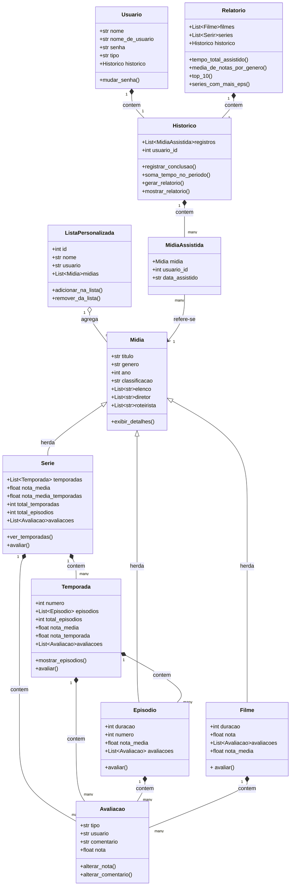

# PipoCLI 🍿
 Esse projeto faz parte da disciplina de Programação Orientada a Objetos (ES0008), feito para trabalhar os conhecimentos adquiridos ao longo da cadeira e nas disciplinas anteriores.

## Sumário
- [Descrição do Projeto](#descrição-do-projeto)
- [Pré-Requisitos](#pré-requisitos)
- [Guia de Instalação](#guia-de-instalação)
- [Comandos Pipocli](#comandos-pipocli)
- [Estrutura de Pastas](#estrutura-de-pastas)
- [Estrutura de Classes](#estrutura-de-classes)

## Descrição do Projeto

Sistema de linha de comando (CLI) para gerencia de um catálogo pessoal de filmes e séries, com avaliações, status de visualização, temporadas/episódios, histórico e relatórios de consumo de mídia. O sistema permite o usuário montar seu próprio catálogo, marcar mídias como assistidas, avaliar e visualizar as avaliações, gerenciar o perfil do usuário e configurações, além de gerar relatórios.

## Pré-Requisitos
Para executar o programa, basta ter o Python e o Git instalados na sua máquina

## Guia de Instalação

### Windows

No PowerShell ou no Prompt de Comando, clone o repositório:
```PowerShell
git clone https://github.com/Marcovinici/POO-PROJETO1-TEMA-10-CATALOGO-DE-FILMES-E-SERIES.git
```
Depois entre no arquivo do repositório com ```cd POO-PROJETO1-TEMA-10-CATALOGO-DE-FILMES-E-SERIES``` e crie um ambiente virtual com:
```PowerShell
python -m venv .venv
```
Para ativar o venv execute no PowerShell:
```PowerShell
.\.venv\Scripts\Activate.ps1
```
Caso o comando acima seja negado, abra o Power Shell como Administrador e execute o comando para liberar a execução de scripts do usuário:
```PowerShell
Set-ExecutionPolicy RemoteSigned -Scope CurrentUser
```
E pressione Enter se o PowerShell pedir confirmação. Feito isso, tente executar o comando anterior novamente, é esperado que o venv seja ativado.
E caso esteja executando os comandos no Prompt de Comando para ativar o venv execute:
```
.\.venv\Scripts\activate.bat
```
Por fim, atualize o pip e instale o projeto com as dependências com:
```PowerShell
pip install .
```
### Linux/Mac
No bash ou zsh, clone o repositório:
```bash
git clone https://github.com/Marcovinici/POO-PROJETO1-TEMA-10-CATALOGO-DE-FILMES-E-SERIES.git
```
Entre no arquivo do repositório com ```cd POO-PROJETO1-TEMA-10-CATALOGO-DE-FILMES-E-SERIES```e crie o ambiente virtual com:
```bash
python -m venv .venv
```
OBS: Caso o comando acima retorne um erro em vez de ```python``` digite ```python3```
Para ativar o ambiente execute:
```bash
source .venv/bin/activate
```
Por fim atualize o pip e instale o projeto com:
```bash
pip install --upgrade pip
pip install .
```

Para confirmar que o programa foi instalado execute:
```bash
pipocli usuario
```
É esperado que seja retornado uma mensagem informando que não há nenhum usuário logado

## Comandos Pipocli

### Autenticação e usuário

#### ```pipocli logar <nome_de_usuario> <senha>``` 
#### ```pipocli cad-usuario <nome_de_usuario> <senha> <nome> [--admin]```
#### ```pipocli usuario```
#### ```pipocli usuario alter-senha <nova_senha>```
#### ```pipocli logout```

### Registro de mídias assistidas

#### ```pipocli assistir filme <titulo> [--ano ANO]```
#### ```pipocli assistir episodio <serie> <temporada> <episodio> [--ano ANO]```

### Adição de itens ao catálogo

#### ```pipocli adicionar filme <titulo> <duracao> <ano> <classificacao> [--gen GENERO] [--elen ELENCO ...] [--dir DIRETOR ...] [--rot ROTEIRISTA ...]```
#### ```pipocli adicionar serie <titulo> <ano> <classificacao> [--gen GENERO] [--elen ELENCO ...] [--dir DIRETOR ...] [--rot ROTEIRISTA ...]```
#### ```pipocli adicionar temporada <serie> <ano> <numero> <titulo_episodio> <duracao_episodio> <ano_episodio> <numero_episodio> <classificacao> [--gen GENERO]```
#### ```pipocli adicionar episodio <serie> <ano> <temporada> <numero> <titulo> <duracao> <ano_episodio> <classificacao> [--gen GENERO]```
#### ```pipocli adicionar lista <nome_da_lista>```

### Listagem do catálogo

#### ```pipocli listar filmes```
#### ```pipocli listar series```
#### ```pipocli listar midias```
#### ```pipocli listar temporadas <serie> [--ano ANO]```
#### ```pipocli listar episodios <serie> <temporada> [--ano ANO]```
#### ```pipocli listar listas```

### Histórico de visualização

#### ```pipocli listar filmes-assistidos```
#### ```pipocli listar series-assistidas```
#### ```pipocli listar series-assistindo```
#### ```pipocli listar ultimas-assistidas [--limite N]```

### Listas personalizadas

#### ```pipocli lista <nome_da_lista> mostrar``` 
#### ```pipocli lista <nome_da_lista> adicionar filme <nome_do_filme>```
#### ```pipocli lista <nome_da_lista> adicionar serie <nome_da_serie>```
#### ```pipocli lista <nome_da_lista> remover-filme <nome_do_filme>```
#### ```pipocli lista <nome_da_lista> remover-serie <nome_da_serie>```

### Remoção de itens do catálogo

#### ```pipocli remover filme <titulo> [--ano ANO]```
#### ```pipocli remover serie <titulo> [--ano ANO]```
#### ```pipocli remover temporada <serie> <temporada> [--ano ANO]```
#### ```pipocli remover episodio <serie> <temporada> <episodio> [--ano ANO]```

### Informações detalhadas

#### ```pipocli info filme <titulo> [--ano ANO]```
#### ```pipocli info serie <serie> [--ano ANO]```
#### ```pipocli info temporada <serie> <temporada> [--ano ANO]```
#### ```pipocli info episodio <serie> <temporada> <episodio> [--ano ANO]```

### Avaliações

#### Registrar avaliação:
#### ```pipocli avaliar filme <titulo> <nota> [--ano ANO] [--comentario TEXTO]```
#### ```pipocli avaliar serie <serie> <nota> [--ano ANO] [--comentario TEXTO]```
#### ```pipocli avaliar temporada <serie> <temporada> <nota> [--ano ANO] [--comentario TEXTO]```
#### ```pipocli avaliar episodio <serie> <temporada> <episodio> <nota> [--ano ANO] [--comentario TEXTO]```
#### Consultar avaliações:
#### ```pipocli avaliacoes filme <titulo> [--ano ANO]```
#### ```pipocli avaliacoes serie <serie> [--ano ANO]```
#### ```pipocli avaliacoes temporada <serie> <temporada> [--ano ANO]```
#### ```pipocli avaliacoes episodio <serie> <temporada> <episodio> [--ano ANO]```

### Recomendações

#### ```pipocli recomendados```

### Relatórios

#### ```pipocli relatorio generos```
#### ```pipocli relatorio tempo```
#### ```pipocli relatorio top10```
#### ```pipocli relatorio series-episodios```

### Configurações

#### ```pipocli config mostrar```
#### ```pipocli config recomendadosmin <valor>```
#### ```pipocli config listasmax <valor>```
#### ```pipocli config metrica <horas|minutos>```

## Decisões de Design
- O projeto foi separado em domain (classes domínio), repositories (classes responsáveis pela manipulação da persistência) e app (interface cli)
- Sqlite3 foi utilizado para a persistência
- As configurações são armazenadas em um arquivo json (config.json)

## Estrutura de Pastas
```text
POO-PROJETO1-TEMA-10-CATALOGO-DE-FILMES-E-SERIES/
├── .gitignore
├── LICENSE
├── README.md
├── pyproject.toml
├── src/
│   ├── app/
│   │   ├── __init__.py
│   │   └── cli.py
│   ├── database/
│   │   ├── banco.db
│   │   ├── banco_scripts.py
│   │   └── config.json
│   ├── domain/
│   │   ├── __init__.py
│   │   ├── avaliacao.py
│   │   ├── config.py
│   │   ├── excecoes.py
│   │   ├── historico.py
│   │   ├── listas.py
│   │   ├── midia_assistida.py
│   │   ├── midias.py
│   │   ├── mixins.py
│   │   ├── relatorios.py
│   │   └── usuario.py
│   └── repositories/
│       ├── __init__.py
│       ├── avaliacao_repository.py
│       ├── config_repository.py
│       ├── filme_repository.py
│       ├── historico_repository.py
│       ├── listas_repository.py
│       ├── midia_assistida_repository.py
│       ├── relatorios_repository.py
│       ├── serie_repository.py
│       ├── sessao.py
│       └── usuario_repository.py
└── tests/
    └── test_01.py
```


## Estrutura de Classes


