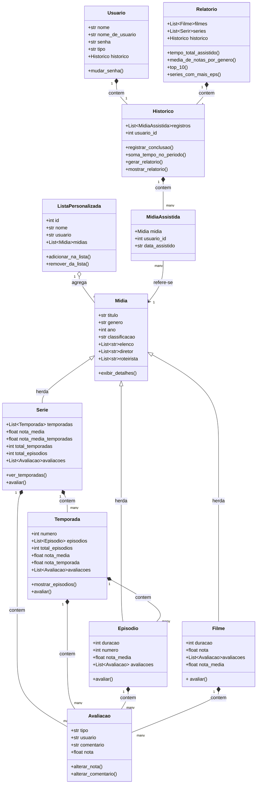

# PipoCLI 🍿
 Esse projeto faz parte da disciplina de Programação Orientada a Objetos (ES0008), feito para trabalhar os conhecimentos adquiridos ao longo da cadeira e nas disciplinas anteriores.

## Descrição  do Projeto

Sistema de linha de comando (CLI) ou API mínima (FastAPI/Flask, opcional) para gerenciar um catálogo pessoal de filmes e séries, com avaliações, status de visualização, temporadas/episódios, histórico e relatórios de consumo de mídia.

## Objetivos

O sistema deve permitir acompanhar o progresso de séries e comparar avaliações entre mídias, gerenciar o perfil do usuário e configurações.

## Guia de Instalação

### Windows

No PowerShell ou no Prompt de Comando, clone o repositório:
```PowerShell
git clone https://github.com/Marcovinici/POO-PROJETO1-TEMA-10-CATALOGO-DE-FILMES-E-SERIES.git
```
Depois entre no arquivo do repositório com ```cd POO-PROJETO1-TEMA-10-CATALOGO-DE-FILMES-E-SERIES``` e crie um ambiente virtual com:
```PowerShell
python -m venv .venv
```
Para ativar o venv execute no PowerShell:
```PowerShell
.\venv\Scripts\Activate.ps1
```
Caso o comando acima seja negado, abra o Power Shell como Administrador e execute o comando para liberar a execução de scripts do usuário:
```PowerShell
Set-ExecutionPolicy RemoteSigned -Scope CurrentUser
```
E pressione Enter se o PowerShell pedir confirmação. Feito isso, tente executar o comando anterior novamente, é esperado que o venv seja ativado.
E caso esteja executando os comandos no Prompt de Comando para ativar o venv execute:
```
.\.venv\Scripts\activate.bat
```
Por fim, atualize o pip e instale o projeto com as dependências com:
```PowerShell
pip install .
```
### Linux/Mac
No bash ou zsh, clone o repositório:
```bash
git clone https://github.com/Marcovinici/POO-PROJETO1-TEMA-10-CATALOGO-DE-FILMES-E-SERIES.git
```
Entre no arquivo do repositório com ```cd POO-PROJETO1-TEMA-10-CATALOGO-DE-FILMES-E-SERIES```e crie o ambiente virtual com:
```bash
python -m venv .venv
```
OBS: Caso o comando acima retorne um erro em vez de ```python``` digite ```python3```
Para ativar o ambiente execute:
```bash
source .venv/bin/activate
```
Por fim atualize o pip e instale o projeto com:
```bash
pip install --upgrade pip
pip install .
```

Para confirmar que o programa foi instalado execute:
```bash
pipocli usuario
```
É esperado que seja retornado uma mensagem informando que não há nenhum usuário logado

## Comandos Pipocli


## Estrutura de Pastas
```text
POO-PROJETO1-TEMA-10-CATALOGO-DE-FILMES-E-SERIES/
├── .gitignore
├── LICENSE
├── README.md
├── pyproject.toml
├── src/
│   ├── app/
│   │   ├── __init__.py
│   │   └── cli.py
│   ├── database/
│   │   ├── banco.db
│   │   └── banco_scripts.py
│   ├── domain/
│   │   ├── __init__.py
│   │   ├── avaliacao.py
│   │   ├── config.py
│   │   ├── excecoes.py
│   │   ├── historico.py
│   │   ├── listas.py
│   │   ├── midia_assistida.py
│   │   ├── midias.py
│   │   ├── mixins.py
│   │   ├── relatorios.py
│   │   └── usuario.py
│   └── repositories/
│       ├── __init__.py
│       ├── avaliacao_repository.py
│       ├── config_repository.py
│       ├── filme_repository.py
│       ├── historico_repository.py
│       ├── listas_repository.py
│       ├── midia_assistida_repository.py
│       ├── relatorios_repository.py
│       ├── serie_repository.py
│       ├── sessao.py
│       └── usuario_repository.py
└── tests/
    └── test_01.py
```


## Estrutura de Classes


## Pipocli Comandos

### Comandos globais


| AÇÃO                                                                            | COMANDO                                         | DISPONÍVEL |
| ------------------------------------------------------------------------------- | ----------------------------------------------- | ---------- |
| Logar o usuário                                                                 | `pipocli logar <usuario> <senha>`               | SIM        |
| Cadastrar um novo usuário (para cadastrar usuario administrador usa-se --admin) | `pipocli cad-usuario <usuario> <senha> --admin` | SIM        |


### Comandos de Usuário

| AÇÃO                            | COMANDO                       | DISPONÍVEL |
| ------------------------------- | ----------------------------- | ---------- |
| Checar qual usuário está logado | `pipocli usuario`             | SIM        |
| Alterar senha                   | `pipocli usuario alter-senha <nova_senha>` | SIM |

#### Manipulação de conteúdos

| AÇÃO                                       | COMANDO                                                                                                                                                        | DISPONÍVEL |
| ------------------------------------------ | -------------------------------------------------------------------------------------------------------------------------------------------------------------- | ---------- |
| Listar todas as mídias do catálogo         | `pipocli listar midias`                                                                                                                                        | SIM |
| Adicionar filme ao catálogo                | `pipocli adicionar filme` + todos os argumentos  necessários e `--gen <genero>`  ,  `--elen <elenco>`, `--dir <diretor>`, ` --rot <roteirista>` como opcionais | SIM        |
| Listar todos os filmes disponíveis         | `pipocli listar filmes`                                                                                                                                        | SIM        |
| Adicionar série ao catálogo                | `pipocli adicionar serie`+ todos os argumentos  necessários e `--gen <genero>`  ,  `--elen <elenco>`, `--dir <diretor>`, ` --rot <roteirista>` como opcionais  | SIM        |
| Adicionar temporada a serie                | `pipocli adicionar temporada <serie> <ano> <numero> <titulo_ep> <duracao_ep> <ano_ep> <numero_ep> <classificacao>` | SIM |
| Adicionar episódio a temporada             | `pipocli adicionar episodio <serie> <ano> <temporada> <numero> <titulo> <duracao> <ano_ep> <classificacao>` | SIM |
| Listar temporadas de uma serie             | `pipocli listar temporadas <serie> [--ano ANO]` | SIM |
| Listar episódios de uma temporada          | `pipocli listar episodios <serie> <temporada> [--ano ANO]` | SIM |
| Listar todas as séries disponíveis         | `pipocli listar series`                                                                                                                                        | SIM        |
| Ver determinada lista de mídias disponível | `pipocli lista mostrar <nome_da_lista>`                                                                                                                        | SIM        |
| Ver listas de mídias disponíveis           | `pipocli listar listas`                                                                                                                                        | SIM        |
| Adicionar nova lista ao catálogo           | `pipocli adicionar lista`                                                                                                                                      | SIM        |
| Adicionar nova mídia a lista               | `pipocli lista <nome_da_lista> adicionar filme <nome_do_filme>` ou `pipocli lista <nome_da_lista> adicionar serie <nome_da_serie>`                             | SIM        |
| Ver lista de Recomendados                  | `pipocli recomendados` | SIM |
| Remover filme de uma lista                 | `pipocli lista <nome> remover-filme <filme>` | SIM |
| Remover série de uma lista                 | `pipocli lista <nome> remover-serie <serie>` | SIM |
| Remover filme do catálogo                  | `pipocli remover filme <titulo> [--ano ANO]` | SIM |
| Remover série do catálogo                  | `pipocli remover serie <titulo> [--ano ANO]` | SIM |
| Remover temporada de uma serie             | `pipocli remover temporada <serie> <temporada> [--ano ANO]` | SIM |
| Remover episodio de uma temporada          | `pipocli remover episodio <serie> <temporada> <episodio> [--ano ANO]` | SIM |
#### Visualização,  Avaliação, Histórico e Relatórios

| AÇÃO                                                  | COMANDO | DISPONÍVEL |
| ----------------------------------------------------- | ------- | ---------- |
| Assistir filme                                        | `pipocli assistir filme <titulo> [--ano ANO]` | SIM |
| Assistir episódio                                     | `pipocli assistir episodio <serie> <temporada> <episodio> [--ano ANO]` | SIM |
| Ver informações da série                              | `pipocli info serie <serie> [--ano ANO]` | SIM |
| Ver informações da temporada                          | `pipocli info temporada <serie> <temporada> [--ano ANO]` | SIM |
| Ver informações do episódio                           | `pipocli info episodio <serie> <temporada> <episodio> [--ano ANO]` | SIM |
| Ver informações do filme                              | `pipocli info filme <titulo> [--ano ANO]` | SIM |
| Avaliar filme                                         | `pipocli avaliar filme <titulo> <nota> [--comentario TEXTO]` | SIM |
| Avaliar episódio                                      | `pipocli avaliar episodio <serie> <temporada> <episodio> <nota> [--ano ANO]` | SIM |
| Avaliar temporada                                     | `pipocli avaliar temporada <serie> <temporada> <nota> [--ano ANO]` | SIM |
| Avaliar série                                         | `pipocli avaliar serie <serie> <nota> [--ano ANO]` | SIM |
| Ver avaliações de filme                               | `pipocli avaliacoes filme <titulo> [--ano ANO]` | SIM |
| Ver avaliações de episódio                            | `pipocli avaliacoes episodio <serie> <temporada> <episodio> [--ano ANO]` | SIM |
| Ver avaliações de temporada                           | `pipocli avaliacoes temporada <serie> <temporada> [--ano ANO]` | SIM |
| Ver avaliações de série                               | `pipocli avaliacoes serie <serie> [--ano ANO]` | SIM |
| Listar filmes assistidos                              | `pipocli listar filmes-assistidos` | SIM |
| Listar series assistidas e que estão sendo assistidas | `pipocli listar series-assistidas` | SIM |
| Listar últimas mídias assistidas                      | `pipocli listar ultimas-assistidas [--limite N]` | SIM |
| Relatório de média de notas por gênero                | `pipocli relatorio generos` | SIM |
| Relatório de tempo total assistido                    | `pipocli relatorio tempo` | SIM |
| Relatótio do Top10 filmes/series                      | `pipocli relatorio top10` | SIM |
| Relatório de séries com maior número de episódios     | `pipocli relatorio series-episodios` | SIM |
#### Configurações

| AÇÃO                                                | COMANDO | DISPONÍVEL |
| --------------------------------------------------- | ------- | ---------- |
| Ver configurações atuais                            | `pipocli config ver` | SIM |
| Alterar nota mínima para "recomendado"              | `pipocli config nota <valor>` | SIM |
| Alterar limite de listas personalizadas por usuário | `pipocli config listas <valor>` | SIM |
| Alterar métrica de duração                          | `pipocli config metrica horas\|minutos` | SIM |


### Comandos de Administrador

| AÇÃO                                 | COMANDO                   | DISPONÍVEL |
| ------------------------------------ | ------------------------- | ---------- |
| Listar todos os usuários do catálogo | `pipocli listar-usuarios` | SIM        |
