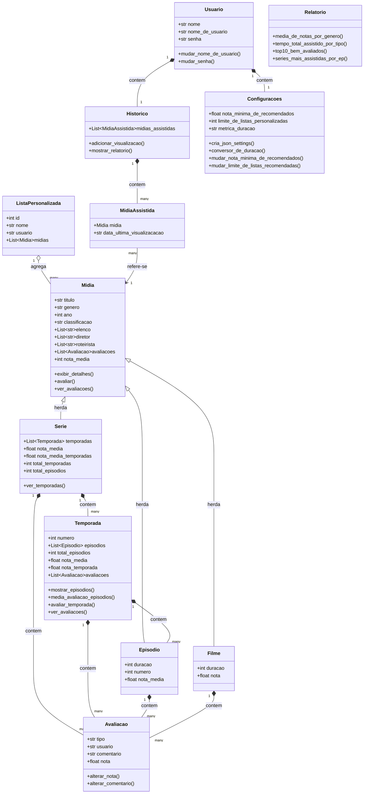

# PipoCLI 🍿
 Esse projeto faz parte da disciplina de Programação Orientada a Objetos (ES0008), feito para trabalhar os conhecimentos adquiridos ao longo da cadeira e nas disciplinas anteriores.

## Descrição  do Projeto

Sistema de linha de comando (CLI) ou API mínima (FastAPI/Flask, opcional) para gerenciar um catálogo pessoal de filmes e séries, com avaliações, status de visualização, temporadas/episódios, histórico e relatórios de consumo de mídia.

## Objetivos

O sistema deve permitir acompanhar o progresso de séries e comparar avaliações entre mídias, gerenciar o perfil do usuário e configurações.

## Estrutura de Pastas
```text
POO-PROJETO1-TEMA-10-CATALOGO-DE-FILMES-E-SERIES/
├── .gitignore
├── LICENSE
├── README.md
├── pyproject.toml
├── src/
│   ├── app/
│   │   ├── __init__.py
│   │   └── cli.py
│   ├── database/
│   │   ├── banco.db
│   │   └── banco_scripts.py
│   ├── domain/
│   │   ├── __init__.py
│   │   ├── avaliacao.py
│   │   ├── config.py
│   │   ├── excecoes.py
│   │   ├── historico.py
│   │   ├── listas.py
│   │   ├── midia_assistida.py
│   │   ├── midias.py
│   │   ├── mixins.py
│   │   ├── relatorios.py
│   │   └── usuario.py
│   └── repositories/
│       ├── __init__.py
│       ├── avaliacao_repository.py
│       ├── config_repository.py
│       ├── filme_repository.py
│       ├── historico_repository.py
│       ├── listas_repository.py
│       ├── midia_assistida_repository.py
│       ├── relatorios_repository.py
│       ├── serie_repository.py
│       ├── sessao.py
│       └── usuario_repository.py
└── tests/
    └── test_01.py
```

## Estrutura de Classes

